<p align="center">
  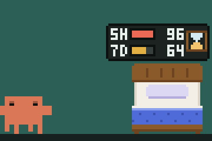
</p>

<h1 align="center">claude-a-gotchi</h1>

<p align="center">
  Ein kleines Pixel-Haustier für Claude Code unter Windows.<br>
  Clawd wohnt in der Ecke deines Bildschirms, reagiert auf Claude Code,<br>
  zeigt dein Limit über seinem Bett und geht schlafen, wenn es aufgebraucht ist.
</p>

<p align="center">
  <a href="https://github.com/v1ncherry/claude-a-gotchi/releases/latest"><b>Download</b></a> ·
  <a href="#eigenes-kostüm-bauen">Kostüm bauen</a> ·
  <a href="CONTRIBUTING.md">Mitmachen</a> ·
  <a href="README.md">English</a>
</p>

> **Inoffizielles Fanprojekt.** claude-a-gotchi stammt nicht von Anthropic und wird von Anthropic weder unterstützt noch empfohlen.
> „Claude“ und die Figur Clawd gehören Anthropic. Das hier ist ein Hobbyprojekt eines Fans.

---

## Was er kann

| | |
|---|---|
| 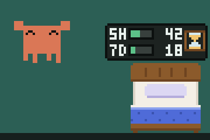 | **Hochheben und werfen.** Zieh Clawd irgendwohin auf dem Bildschirm. Lässt du ihn im Schwung los, fliegt er, landet auf Fensterkanten und Tabs oder federt auf seinem Bett. |
| 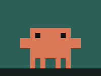 | **Er reagiert auf Claude Code.** Konzentriert (und tippend), während Claude arbeitet, überrascht, wenn es dich braucht, wütend, wenn du es warten lässt, stolz, wenn eine Aufgabe fertig ist, verwirrt nach einem Fehler. |

- **Limit über dem Bett.** Zwei kleine Pixelbalken zeigen das 5-Stunden- und das Wochenlimit, dazu eine Sanduhr, die in 5 Stunden durchläuft und sich umdreht, wenn ein neues Fenster beginnt.
- **Schläft, wenn das Limit erreicht ist.** Er läuft zu seinem Bett, deckt sich zu und wacht auf, sobald du wieder arbeiten kannst.
- **Traurig, wenn es knapp wird.** Ab einer Schwelle, die du einstellst (Standard 90 %), weint er ein bisschen und schwitzt.
- **Streicheln und ärgern.** Lass die Maus auf ihm liegen, und er verliebt sich. Klick viermal hintereinander, und er wird wütend.
- **Schnellmenü.** Klick auf sein Bett: deine Limits, *Chat öffnen* (Claude-App), *Code öffnen* (Terminal mit `claude` in deinem letzten Projekt), Anpassen, Schlafen, Einstellungen.
- **Stört nicht.** Klicks gehen durch alles außer Clawd und sein Bett. Bei Vollbild versteckt er sich. Meist döst er in seiner Ecke und braucht dabei etwa 0,01 % CPU.
- **Deutsch und Englisch**, weitere Sprachen sind willkommen ([so geht's](CONTRIBUTING.md#translations)).

## Installieren

1. Lade **`claude-a-gotchi-<version>-setup.exe`** aus dem [neuesten Release](https://github.com/v1ncherry/claude-a-gotchi/releases/latest).
2. Starte die Datei. Admin-Rechte brauchst du nicht, installiert wird in deinen Benutzerordner.
3. Windows meldet eventuell *„Der Computer wurde durch Windows geschützt“*. Der Installer ist nicht signiert, weil Zertifikate jedes Jahr Geld kosten. Klick auf **Weitere Informationen → Trotzdem ausführen**. Der Quellcode liegt komplett hier, und jedes Release wird von GitHub Actions aus diesem Repo gebaut.

Der Installer kann die Hooks für Claude Code einrichten, Clawd mit Windows starten und eine Desktop-Verknüpfung anlegen (alle drei sind vorausgewählt). Beim ersten Start fragt ein kleines Willkommensfenster, wo Clawd wohnen soll und ob er dein genaues Limit anzeigen darf.

Lieber ohne Installer? Nimm die **`win-x64.zip`**, entpack sie irgendwo und starte `claude-a-gotchi.exe`. Die Hooks kannst du im Willkommensfenster oder in den Einstellungen einschalten.

**Voraussetzungen:** Windows 10 oder 11, 64 Bit. .NET ist schon dabei. Claude Code ist kein Muss: Ohne wohnt Clawd trotzdem auf deinem Desktop, er hat dann nur weniger zu tun. Entwickelt und getestet wurde unter Windows 11.

## Kostüme

Jedes Kostüm ist eine kleine Textdatei, deshalb kann jeder neue bauen ([siehe unten](#eigenes-kostüm-bauen)).

<p align="center">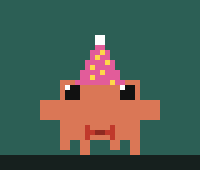</p>

**Hüte**
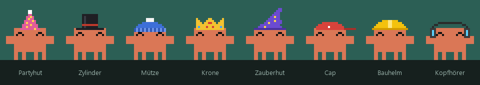

**Outfits**
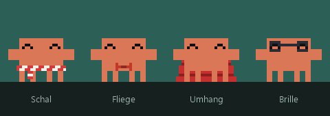

**Farben**
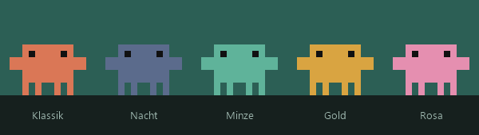

**Betten und Bezüge.** Vier Bettgestelle, sechs Bezüge, vier Kissen.
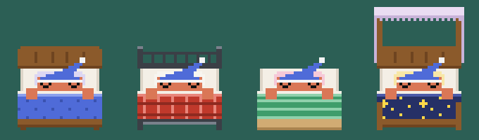
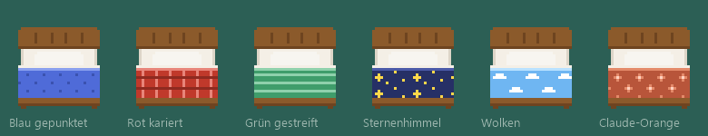

## Das Limit-Schild

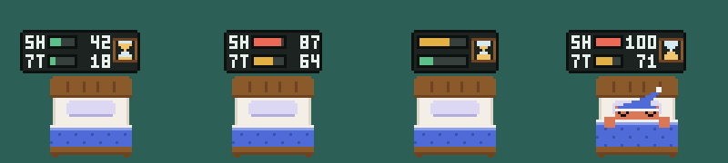

`5H` ist das rollierende 5-Stunden-Limit, `7T` das Wochenlimit. Grün unter 50 %, gelb ab 50 %, rot ab 80 %. Du kannst zwischen *Text und Prozent* und *Nur Balken* wechseln und die Sanduhr ausschalten.

Woher die Zahlen kommen:

- **Schätzung (Standard).** Clawd liest deine lokalen Claude-Code-Protokolle (`~/.claude/projects`). Aus den Tokens früherer Fenster, in denen das Limit erreicht wurde, schätzt er, wie voll das aktuelle Fenster ist (angezeigt mit `≈`). Ist ein Limit erreicht, steht das samt Reset-Zeit in den Protokollen.
- **Genau (freiwillig, musst du selbst einschalten).** Clawd fragt mit deinem Claude-Code-Login bei Anthropic nach, über dieselbe Adresse, die auch `/usage` in Claude Code nutzt. Diese Adresse ist **inoffiziell und nicht dokumentiert**: Sie kann sich jederzeit ändern oder wegfallen, und Anthropic hat nicht gesagt, ob fremde Programme sie nutzen dürfen. Die Entscheidung liegt bei dir.

## Die Fenster

| Schnellmenü (Klick aufs Bett) | Anpassen |
|---|---|
| 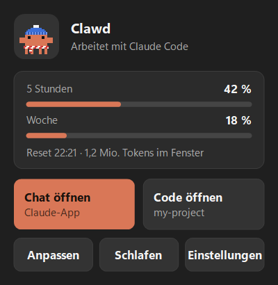 | 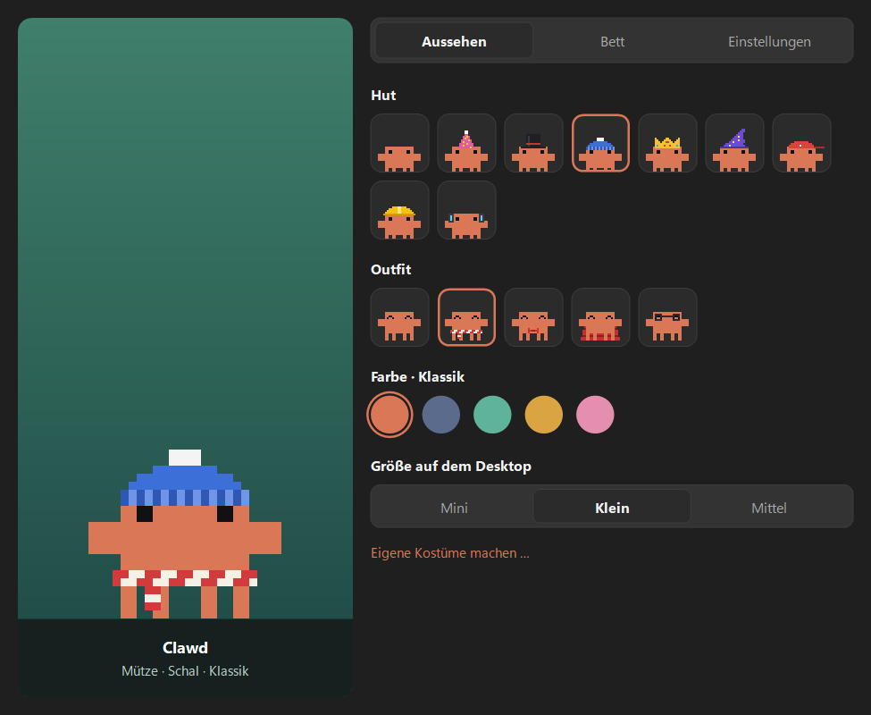 |

| Bett | Einstellungen |
|---|---|
| 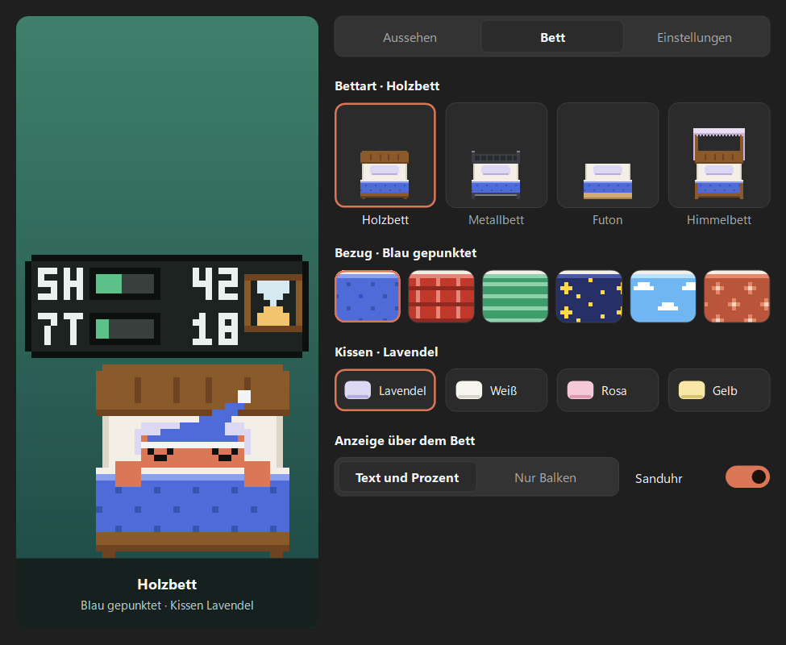 | 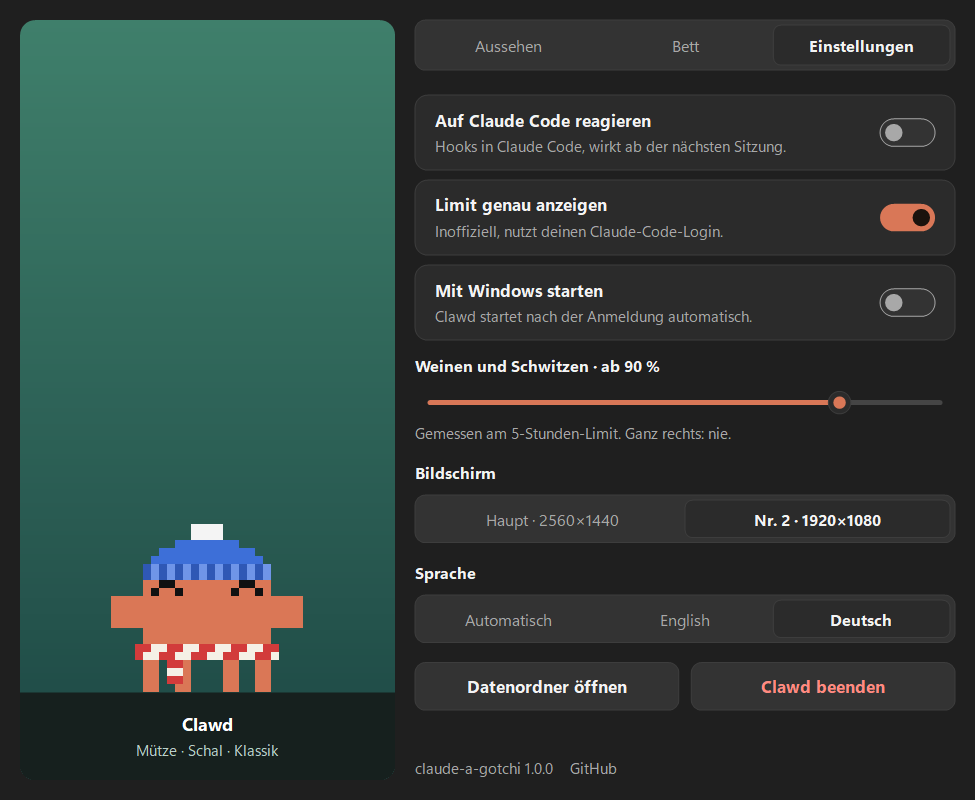 |

## Datenschutz

- **Hooks:** Claude Code startet `claude-a-gotchi.exe --hook <Ereignis>`, wenn du etwas abschickst, nach Werkzeugaufrufen, bei Benachrichtigungen und wenn es fertig ist. Der Hook behält nur das Ereignis, den Arbeitsordner und ob ein Werkzeug einen Fehler gemeldet hat, und schreibt das nach `%LOCALAPPDATA%\claude-a-gotchi\state.json`. Ein Aufruf dauert etwa 60 ms.
- **Lokale Protokolle** werden nur auf deinem Rechner gelesen. Nichts daraus verlässt ihn.
- **Netzwerk:** Ist *Limit genau anzeigen* an, geht alle 5 Minuten eine Anfrage mit deinem Claude-Code-Token an `api.anthropic.com`. Einmal am Tag fragt die App bei der öffentlichen GitHub-API, ob es eine neue Version gibt. Sonst nichts, keine Statistik, keine Telemetrie.
- **Deine Claude-Code-Einstellungen:** Die Hooks werden in `~/.claude/settings.json` eingetragen, eine Sicherung liegt daneben als `settings.json.claude-a-gotchi-backup`. Geändert oder entfernt werden nur Clawds eigene Einträge.

## Eigenes Kostüm bauen

Ein Kostüm ist eine Textdatei wie diese ([ausführliche Anleitung, auf Englisch](CONTRIBUTING.md#costume-files)):

```text
type: hat
id: party
name: Party hat
name.de: Partyhut
at: -5, -9
colors:
  P = #e25c9a
  Y = #ffd84a
  W = #ffffff
pixels:
  ....WW....
  ....WW....
  ....PP....
  ...PPYP...
  ...PYPP...
  ..PPPPYP..
  ..PYPPPP..
  .PPPPYPPP.
  .PPYPPPPP.
  PPPPPPPYPP
```

Jeder Buchstabe ist ein Pixel in der Farbe, die unter `colors` steht, `.` ist durchsichtig. Zum Ausprobieren klickst du im Tab *Aussehen* auf **Eigene Kostüme machen …**. Das öffnet `%LOCALAPPDATA%\claude-a-gotchi\costumes`. Speicher deine Datei dort und geh zurück ins Einstellungsfenster. Willst du sie mit allen teilen, öffne einen Pull Request: Ein Bot antwortet mit einem Vorschaubild, auf dem Clawd sie trägt.

## Mitmachen

Neue Kostüme, Übersetzungen, Fehlermeldungen und Code sind alle willkommen. Wie das geht, steht in [CONTRIBUTING.md](CONTRIBUTING.md). Bitte bleib freundlich: [Verhaltensregeln](CODE_OF_CONDUCT.md).

<!-- Unterstützen: wird sichtbar, sobald es eine Ko-fi-Seite gibt (siehe README.md).

## Unterstützen

Wenn Clawd deinen Tag ein bisschen netter macht, kannst du mir einen Kaffee ausgeben: https://ko-fi.com/NAME ☕
-->

## Deinstallieren

*Einstellungen → Apps → Installierte Apps → claude-a-gotchi → Deinstallieren.* Dabei werden die Hooks und der Autostart entfernt. Danach fragt der Deinstaller, ob auch deine Einstellungen und eigenen Kostüme gelöscht werden sollen.

## Selbst bauen

Du brauchst das [.NET 8 SDK](https://dotnet.microsoft.com/download/dotnet/8.0).

```powershell
dotnet run --project src/claude-a-gotchi
```

`tools/build.ps1` baut Installer und ZIP (dafür brauchst du [Inno Setup 6](https://jrsoftware.org/isinfo.php)), und `tools/make-media.ps1` erzeugt alle Bilder in diesem README.

## Lizenz

Der Code steht unter der [MIT-Lizenz](LICENSE). Sie gilt nur für den Code, **nicht** für den Namen „Claude“ oder die Figur Clawd. Die gehören Anthropic.
