<p align="center">
  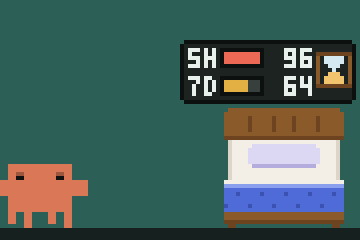
</p>

<h1 align="center">claude-a-gotchi</h1>

<p align="center">
  A tiny pixel desk pet for Claude Code on Windows.<br>
  Clawd lives in the corner of your screen, reacts to what Claude Code is doing,<br>
  shows your usage limits above his bed and goes to sleep when they run out.
</p>

<p align="center">
  <a href="https://github.com/v1ncherry/claude-a-gotchi/releases/latest"><b>Download</b></a> ·
  <a href="#make-your-own-costume">Make a costume</a> ·
  <a href="CONTRIBUTING.md">Contribute</a> ·
  <a href="README.de.md">Deutsch</a>
</p>

> **Unofficial fan project.** claude-a-gotchi is not made, endorsed or supported by Anthropic.
> "Claude" and the Clawd character belong to Anthropic. This is a hobby project by a fan.

---

## What he does

| | |
|---|---|
| 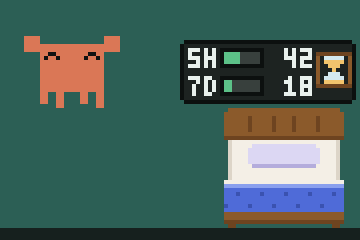 | **Pick him up and throw him.** Drag Clawd anywhere on the screen. Let go mid-swing and he flies, lands on window edges and tabs, or bounces on his bed. |
| 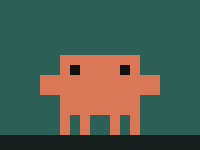 | **He reacts to Claude Code.** Focused (and typing) while Claude works, surprised when it needs you, angry if you keep it waiting, proud when a task is done, confused after an error. |

- **Limits above his bed.** Two small pixel bars show the 5-hour and the weekly limit, with an hourglass that runs out over 5 hours and turns over when a new window starts.
- **Sleeps when the limit is reached.** He walks to his bed, tucks himself in and wakes up when you can work again.
- **Sad when it gets tight.** From a threshold you choose (default 90 %), he cries a little and sweats.
- **Petting and teasing.** Rest the mouse on him and he falls in love. Click him four times in a row and he gets angry.
- **Quick panel.** Click his bed: your limits, *Open chat* (Claude app), *Open code* (a terminal with `claude` in your last project), customize, sleep, settings.
- **Stays out of the way.** Clicks pass through everything except Clawd and his bed. He hides when a window goes fullscreen. Mostly he idles in his corner, using about 0.01 % CPU.
- **English and German**, more languages welcome ([how](CONTRIBUTING.md#translations)).

## Install

1. Download **`claude-a-gotchi-<version>-setup.exe`** from the [latest release](https://github.com/v1ncherry/claude-a-gotchi/releases/latest).
2. Run it. No admin rights needed; it installs into your user folder.
3. Windows may say *"Windows protected your PC"*, because the installer is not code-signed (certificates cost money every year). Click **More info → Run anyway**. The source is all here, and every release is built by GitHub Actions from this repository.

The installer can set up the Claude Code hooks, start Clawd with Windows and create a desktop shortcut (all three are ticked by default). On the first start a small welcome window asks where Clawd should live and whether he may show your exact limits.

Prefer no installer? Take the **`win-x64.zip`**, unpack it anywhere and start `claude-a-gotchi.exe`. You can switch the hooks on in the welcome window or the settings.

**Requirements:** Windows 10 or 11, 64-bit. .NET is included. Claude Code is optional: without it Clawd still lives on your desktop, he just has less to react to. It was made and tested on Windows 11.

## Costumes

Every costume is a small text file, so anyone can make new ones ([see below](#make-your-own-costume)).

<p align="center">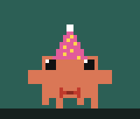</p>

**Hats**
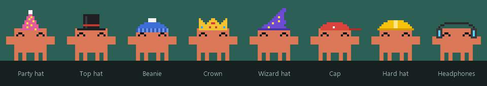

**Outfits**
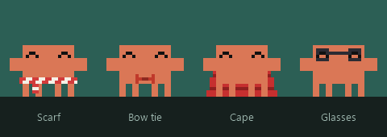

**Colors**
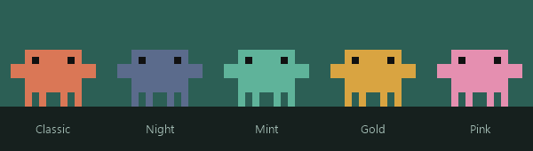

**Beds and covers.** Four bed frames, six covers, four pillows.
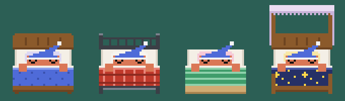
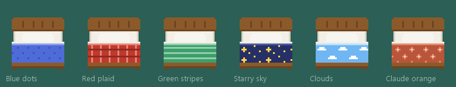

## The limit plate

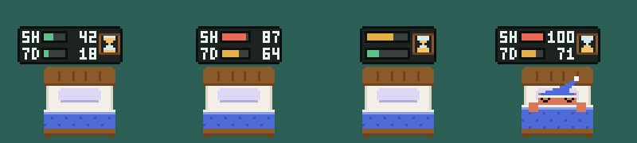

`5H` is the rolling 5-hour limit, `7D` the weekly one. Green below 50 %, yellow from 50 %, red from 80 %. You can switch between *text and percent* and *bars only*, and turn the hourglass off.

Where the numbers come from:

- **Estimate (default).** Clawd reads your local Claude Code logs (`~/.claude/projects`). From the tokens used in earlier windows that hit the limit, he estimates how full the current window is (shown with `≈`). When a limit is reached, the logs say so, together with the time it resets.
- **Exact (optional, you have to switch it on).** Clawd uses your Claude Code login to ask Anthropic's usage endpoint, the same one Claude Code's `/usage` uses. That endpoint is **unofficial and undocumented**: it may change or disappear at any time, and Anthropic has not said whether third-party tools may use it. It's your call.

## The windows

| Quick panel (click the bed) | Customize |
|---|---|
| 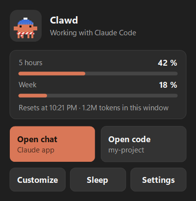 | 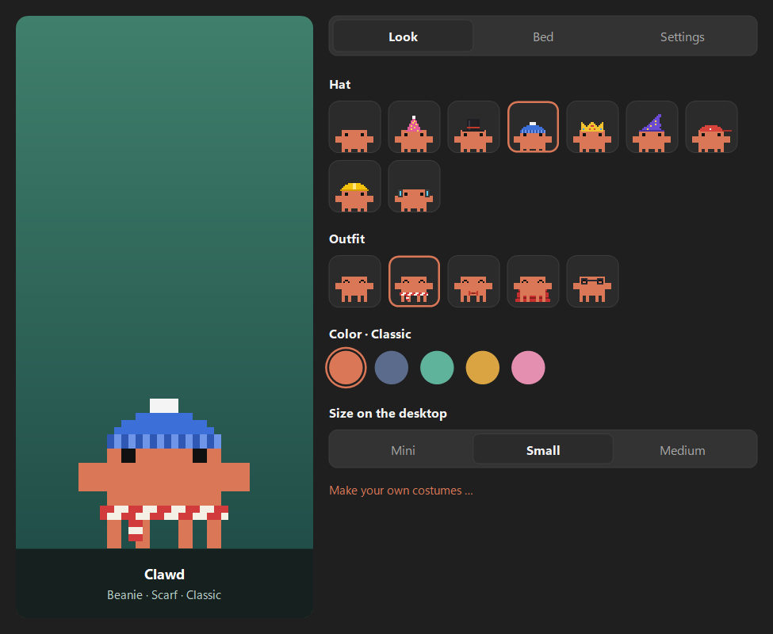 |

| Bed | Settings |
|---|---|
| 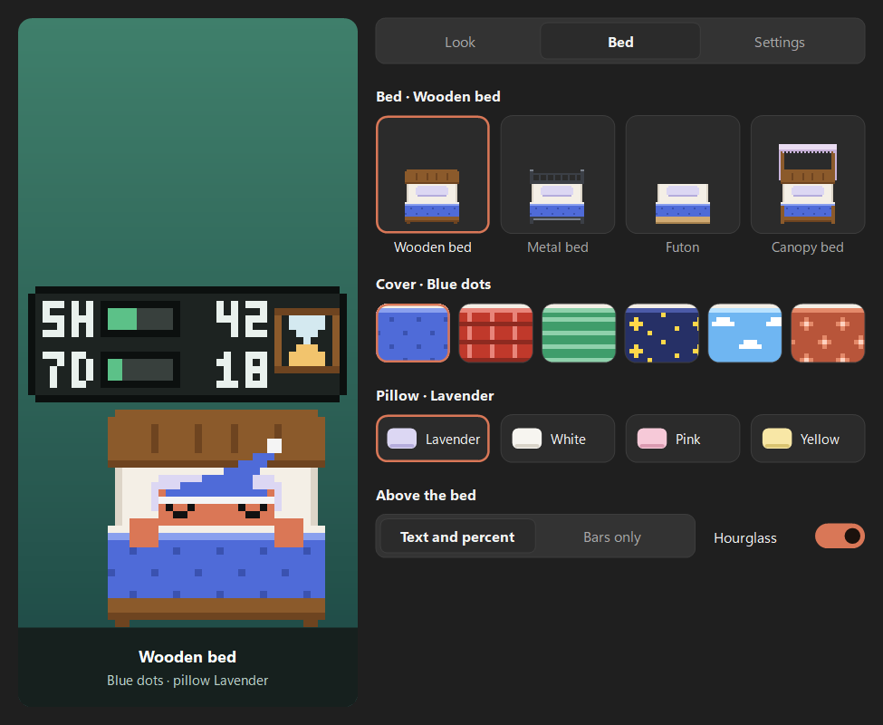 | 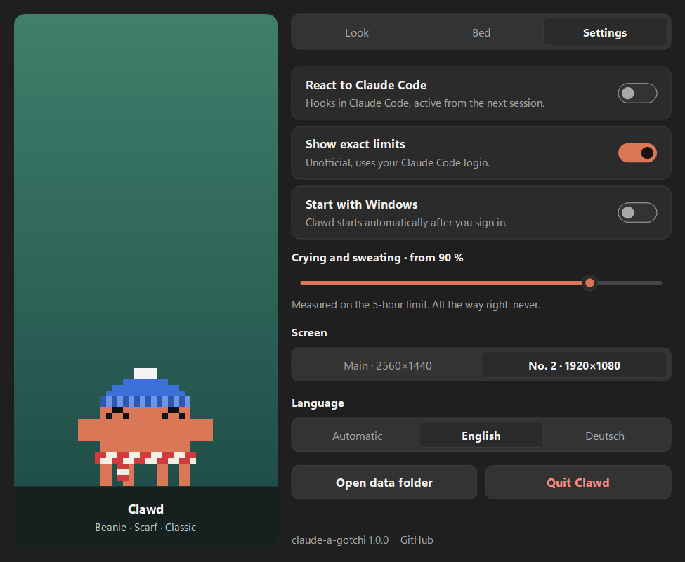 |

## Privacy

- **Hooks:** Claude Code starts `claude-a-gotchi.exe --hook <event>` on prompt submit, after tool calls, on notifications and when it stops. The hook keeps only the event, the working folder and whether a tool reported an error, and writes them to `%LOCALAPPDATA%\claude-a-gotchi\state.json`. One call takes about 60 ms.
- **Local logs** are read only on your computer. Nothing from them leaves it.
- **Network:** with *exact limits* switched on, one request every 5 minutes to `api.anthropic.com` with your Claude Code token. Once a day, one request to the public GitHub API to see if there is a newer release. Nothing else. No analytics, no telemetry.
- **Your Claude Code settings:** the hooks are added to `~/.claude/settings.json`, and a backup is saved next to it as `settings.json.claude-a-gotchi-backup`. Only Clawd's own entries are ever changed or removed.

## Make your own costume

A costume is a text file like this ([full guide](CONTRIBUTING.md#costume-files)):

```text
type: hat
id: party
name: Party hat
name.de: Partyhut
at: -5, -9
colors:
  P = #e25c9a
  Y = #ffd84a
  W = #ffffff
pixels:
  ....WW....
  ....WW....
  ....PP....
  ...PPYP...
  ...PYPP...
  ..PPPPYP..
  ..PYPPPP..
  .PPPPYPPP.
  .PPYPPPPP.
  PPPPPPPYPP
```

Each letter is one pixel in the color listed under `colors`. `.` is see-through. To try it out, click **Make your own costumes …** in the *Look* tab. That opens `%LOCALAPPDATA%\claude-a-gotchi\costumes`. Save your file there, then come back to the settings window. To share it with everyone, open a pull request: a bot answers with a preview picture of Clawd wearing it.

## Contributing

New costumes, translations, bug reports and code are all welcome. [CONTRIBUTING.md](CONTRIBUTING.md) explains how. Please be kind: [Code of Conduct](CODE_OF_CONDUCT.md).

<!-- Support section: shown once a Ko-fi page exists. Set AppInfo.KofiName in src/claude-a-gotchi/AppData.cs,
     uncomment ko_fi in .github/FUNDING.yml and remove this comment wrapper.

## Support

If Clawd makes your day a little nicer, you can buy me a coffee: https://ko-fi.com/NAME ☕
-->

## Uninstall

*Settings → Apps → Installed apps → claude-a-gotchi → Uninstall.* This removes the hooks and the autostart entry, and then asks whether your settings and own costumes should go too.

## Build it yourself

You need the [.NET 8 SDK](https://dotnet.microsoft.com/download/dotnet/8.0).

```powershell
dotnet run --project src/claude-a-gotchi
```

`tools/build.ps1` builds the installer and the ZIP (needs [Inno Setup 6](https://jrsoftware.org/isinfo.php)), and `tools/make-media.ps1` renders every picture in this README.

## License

The code is under the [MIT License](LICENSE). That covers the code only, **not** the name "Claude" or the Clawd character, which belong to Anthropic.
